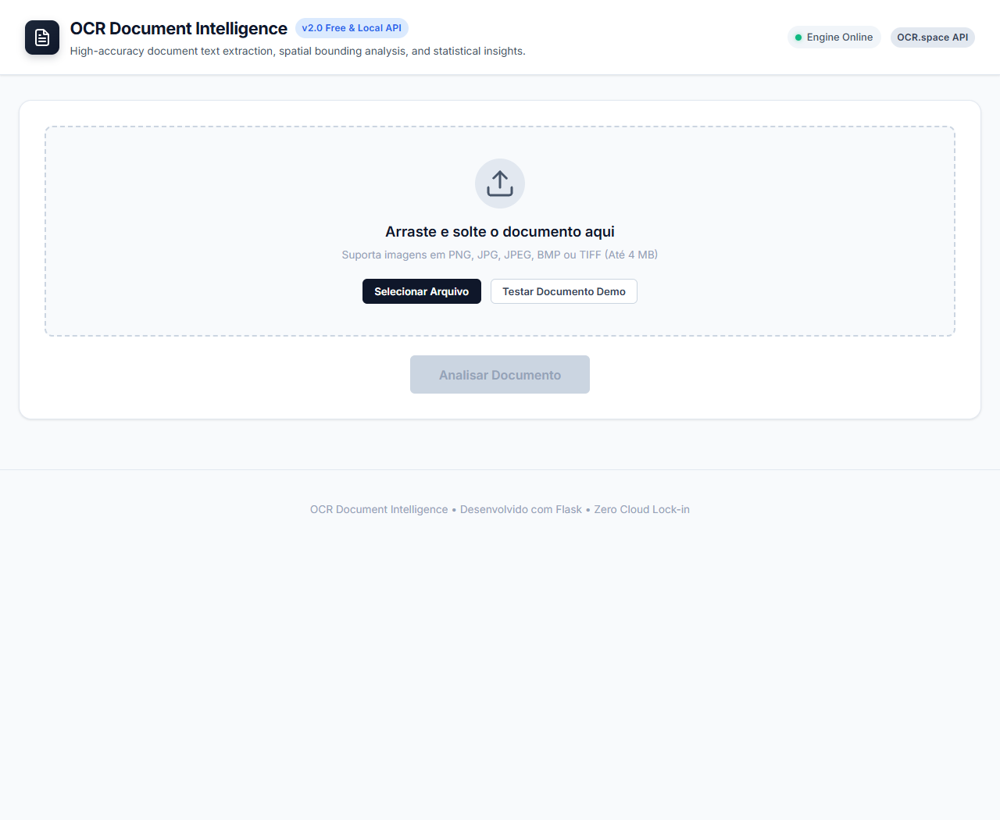
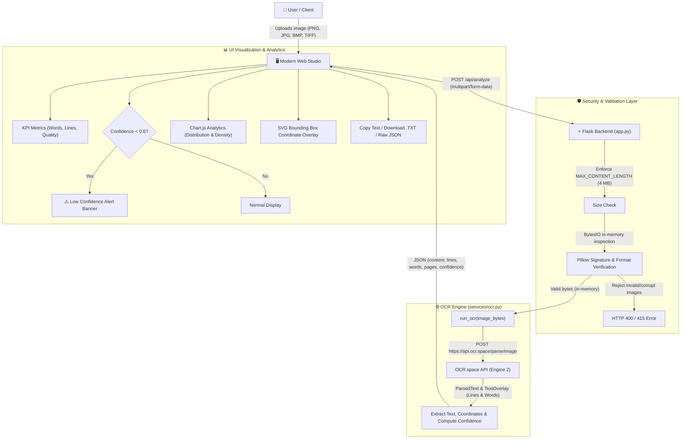

<div align="center">

# 🔍 OCR Document Intelligence Studio
### *Zero Cloud Lock-in • Free Local/Public API • Spatial Analytics & Interactive UI*

[](https://www.python.org/)
[](https://flask.palletsprojects.com/)
[](https://ocr.space/)
[](#-built-in-security--safety)
[](LICENSE)

<br/>

<p align="center">
  A modern, production-grade Optical Character Recognition (OCR) platform built with Flask. Completely detached from proprietary Azure cloud services, utilizing free OCR capabilities, real-time spatial bounding box inspection, and rich analytical charts.
</p>

[Quick Start](#-quick-start-windows-powershell) • [Screenshots](#-ui--analytics-showcase) • [Architecture](#-architecture--data-flow) • [API Documentation](#-rest-api-reference) • [Limitations](#-limitations--service-notes)

</div>

---

## 📑 Table of Contents

- [🌟 Highlights](#-highlights)
- [🖥️ UI & Analytics Showcase](#-ui--analytics-showcase)
- [🏗️ Architecture & Data Flow](#-architecture--data-flow)
- [⚡ Quick Start (Windows PowerShell)](#-quick-start-windows-powershell)
- [⚙️ Configuration & Environment Variables](#-configuration--environment-variables)
- [📊 Visual Analytics & Features](#-visual-analytics--features)
- [📡 REST API Reference](#-rest-api-reference)
- [🛡️ Built-in Security & Safety](#-built-in-security--safety)
- [⚠️ Limitations & Service Notes](#-limitations--service-notes)
- [📂 Project Structure](#-project-structure)
- [📜 License](#-license)

---

## 🌟 Highlights

- **Zero Cloud Lock-in**: All Azure dependencies (`azure-ai-documentintelligence`, `azure-core`) and `APP_MODE` logic removed. Runs smoothly with free OCR.space API access.
- **Dynamic KPI Dashboard**: Instant visibility into extracted word count, line count, character volume, document resolution, and average confidence score.
- **Interactive Visual Analytics**: Embedded Chart.js charts rendering confidence distribution and line-by-line word density.
- **Spatial Bounding Box Inspector**: SVG overlay aligned to original image dimensions with interactive hover tooltips for every recognized segment.
- **Low Confidence Alerts**: Automatic warning banner (`"Low confidence. Please verify the text manually."`) when average confidence falls below `0.6` (60%).
- **Multi-Format Export**: One-click clipboard copy, plain text export (`.txt`), and formatted JSON data inspection.
- **Strict In-Memory Pipeline**: Uploaded images are validated via Pillow and processed entirely in memory—no files are ever written to disk.

---

## 🖥️ UI & Analytics Showcase

### 1. Real-Time Neural Simulation Theatre (React Flow + Optical Scanner)
*Live visual simulation triggered upon analysis: features an optical scanner with laser sweeps and real-time bounding box detection alongside an interactive React Flow node pipeline graph with streaming telemetry logs.*



### 2. Modern Upload Studio & Drag-and-Drop Zone
*Sleek drag-and-drop file interface with format detection, preview thumbnail, and one-click demo test trigger.*


### 3. Analytical Dashboard & Distribution Charts
*Comprehensive KPI metric cards accompanied by Chart.js confidence doughnuts and line density graphs.*


### 4. Spatial Document & Bounding Box Inspection
*Interactive SVG layer displaying detected line coordinates directly over the source document with hover metadata.*


---

## 🏗️ Architecture & Data Flow



---

## ⚡ Quick Start (Windows PowerShell)

Follow these steps to run the application locally on Windows:

### 1. Prerequisites
- **Python 3.10+** (Tested on Python 3.11)
- **PowerShell 5.1+** or **PowerShell 7+**

### 2. Setup Virtual Environment & Install Dependencies

```powershell
# Navigate into the project folder
cd "d:\Projects\Ai-901 ocr"

# Create a virtual environment
python -m venv .venv

# Activate the virtual environment
.\.venv\Scripts\Activate.ps1

# Install required dependencies
pip install -r requirements.txt
```

### 3. Configure Environment Variables

```powershell
# Copy the example environment file
Copy-Item .env.example .env
```

Edit `.env` if desired (the public demo key `helloworld` works out of the box for testing):
```ini
PORT=5001
MAX_UPLOAD_MB=4
OCR_SPACE_API_KEY=helloworld
```

### 4. Launch the Application

```powershell
python app.py
```

Open your browser at **[http://127.0.0.1:5001](http://127.0.0.1:5001)** and upload any document or click **"Testar Documento Demo"** to evaluate `exemplos/documento_demo.png`.

---

## ⚙️ Configuration & Environment Variables

| Variable | Type | Default | Description |
| :--- | :--- | :--- | :--- |
| `PORT` | Integer | `5001` | HTTP port on which the Flask server listens locally. |
| `MAX_UPLOAD_MB` | Integer | `4` | Maximum allowable upload payload in megabytes. |
| `OCR_SPACE_API_KEY` | String | `helloworld` | API Key for OCR.space. Free keys available at [ocr.space/ocrapi/freekey](https://ocr.space/ocrapi/freekey). |

---

## 📊 Visual Analytics & Features

The interface is structured into 5 cohesive modules:

1. **📊 Gráficos de Análise**:
   - **Confidence Doughnut**: Visual breakdown of high ($\ge 85\%$), medium ($60-84\%$), and low ($< 60\%$) confidence recognition.
   - **Line Density Histogram**: Bar chart depicting the word distribution across individual document lines.
2. **🖼️ Inspeção Visual**:
   - Original document rendered with an aligned SVG viewport.
   - Interactive bounding boxes with hover highlights and coordinate metadata.
   - Visibility toggle checkbox for quick comparison.
3. **📄 Texto Extraído**:
   - Complete extracted document body.
   - Quick **"Copiar Texto"** to clipboard and **"Baixar .TXT"** export buttons.
4. **🔍 Linhas e Caixas**:
   - Tabular breakdown of each detected line with exact polygon bounding boxes and confidence badges.
5. **📦 JSON Estruturado**:
   - Formatted syntax tree of the entire API payload with one-click copy.

---

## 📡 REST API Reference

### Analyze Document

Analyzes an image and returns structured text, page geometries, words, and confidence scores.

- **Endpoint**: `POST /api/analyze`
- **Content-Type**: `multipart/form-data`

#### Parameters

| Field | Type | Description |
| :--- | :--- | :--- |
| `image` | File | Image file (`.png`, `.jpg`, `.jpeg`, `.bmp`, `.tiff`). Max size defined by `MAX_UPLOAD_MB`. |

#### Example cURL Request

```bash
curl -X POST http://127.0.0.1:5001/api/analyze \
  -F "image=@exemplos/documento_demo.png"
```

#### Example Response (HTTP 200 OK)

```json
{
  "success": true,
  "confidence": 0.95,
  "content": "DOCUMENTO DEMONSTRATIVO AI-901\nTeste de reconhecimento de texto\nExemplo sem processamento Azure",
  "lines": [
    {
      "content": "DOCUMENTO DEMONSTRATIVO AI-901",
      "confidence": 0.95,
      "bounding_box": [[36, 51], [587, 51], [587, 72], [36, 72]]
    },
    {
      "content": "Teste de reconhecimento de texto",
      "confidence": 0.95,
      "bounding_box": [[33, 130], [424, 130], [424, 147], [33, 147]]
    }
  ],
  "words": [
    {
      "content": "DOCUMENTO",
      "confidence": 0.95,
      "bounding_box": [[36, 51], [223, 51], [223, 72], [36, 72]]
    }
  ],
  "pages": [
    {
      "page_number": 1,
      "width": 780,
      "height": 320,
      "unit": "pixel",
      "lines": [ ... ],
      "words": [ ... ]
    }
  ],
  "styles": []
}
```

---

## 🛡️ Built-in Security & Safety

- **Memory-Only Processing**: Images are streamed directly to `BytesIO` buffers and forwarded to the OCR provider. No user uploads or transient files are saved to the server disk.
- **Pillow Image Sanitization**: Uploaded payloads are validated using `Image.open().verify()` against authorized MIME signatures (`PNG`, `JPEG`, `BMP`, `TIFF`) to block polyglot exploits and malicious non-image payloads.
- **XSS Defense**: All extracted dynamic text is sanitized before DOM injection via a custom `escapeHtml()` utility to prevent Cross-Site Scripting.
- **Payload Size Guards**: Strict HTTP 413 error handlers enforce upload limits defined by `MAX_CONTENT_LENGTH`.

---

## ⚠️ Limitations & Service Notes

1. **Internet Dependency**: Processing relies on the OCR.space web API endpoint. An active internet connection is mandatory.
2. **Free Tier Quotas**: The demo API key (`helloworld`) is rate-limited and shared globally. For production workloads, generate a free personal key with 25,000 requests/month at [ocr.space/ocrapi/freekey](https://ocr.space/ocrapi/freekey).
3. **Confidence Metric**: OCR.space provides spatial layout and exit status codes (`FileParseExitCode`), but does not output individual per-character probabilities. Confidence scores are calculated proportionally based on engine exit codes and structural completeness. If average confidence falls under `0.6` ($60\%$), the alert banner is automatically raised.

---

## 📂 Project Structure

```
d:\Projects\Ai-901 ocr\
├── .env.example              # Environment variable template
├── .gitignore                # Git exclusions (venv, secrets, cache)
├── app.py                    # Flask server entrypoint & REST routing
├── README.md                 # Project documentation & reference
├── requirements.txt          # Python dependencies
├── docs\
│   └── screenshots\          # Application UI & analytics previews
│       ├── preview-home.png
│       ├── preview-dashboard.png
│       └── preview-visual.png
├── exemplos\
│   └── documento_demo.png    # Sample demo document for testing
├── services\
│   ├── __init__.py
│   └── ocr.py                # OCR.space integration & confidence engine
├── static\
│   ├── css\style.css         # Modern styling & design system
│   └── js\script.js          # Interactive dashboard, charts, & SVG boxes
└── templates\
    └── index.html            # Web studio dashboard template
```

---

## 📜 License

Distributed under the **MIT License**. Free for personal, academic, and commercial use.
