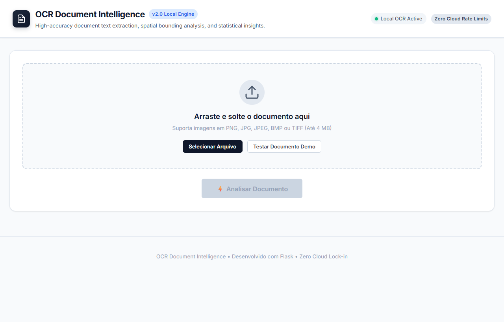
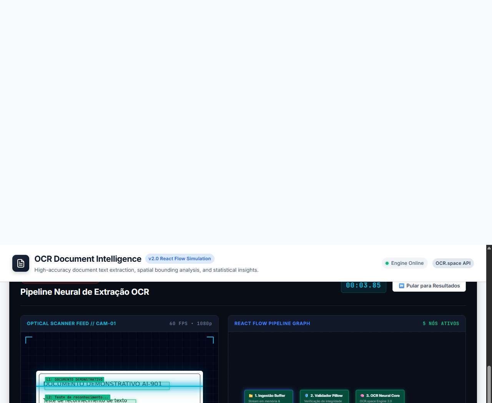
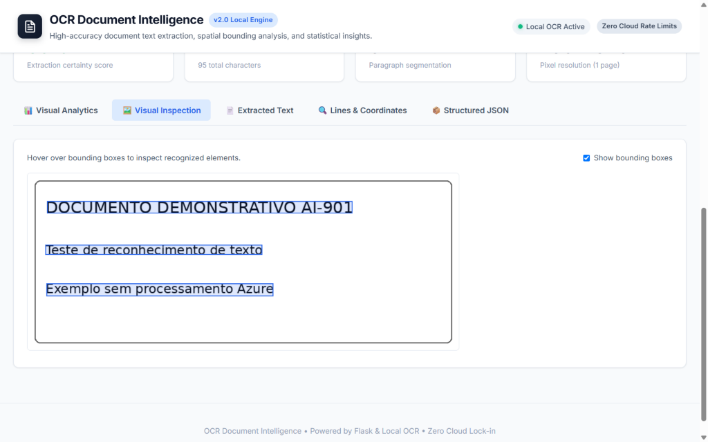
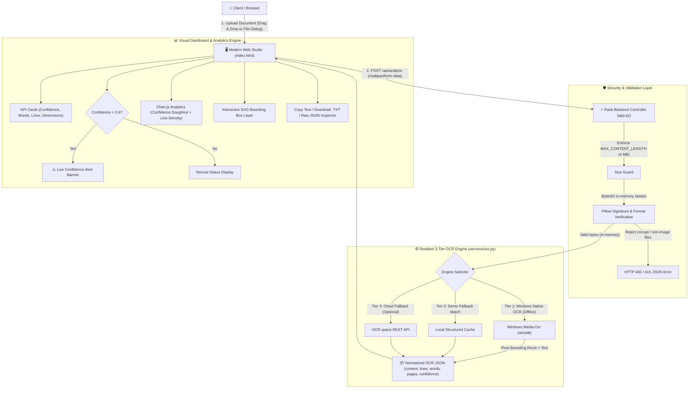

<div align="center">

# 🔍 OCR Document Intelligence Studio
### *Zero Cloud Lock-in • 100% Offline Native Engine • Spatial Analytics & Interactive UI*

[](https://www.python.org/)
[](https://flask.palletsprojects.com/)
[-success?style=for-the-badge&logo=windows&logoColor=white)](https://learn.microsoft.com/en-us/uwp/api/windows.media.ocr)
[](https://ashish-1911.github.io/Ai-901-ocr/)
[](#-security-privacy--data-safety)
[](LICENSE)

<br/>

<p align="center">
  A high-performance, modern Optical Character Recognition (OCR) platform built with Python & Flask. Engineered to completely remove proprietary Azure Document Intelligence cloud dependencies in favor of a lightning-fast, zero-cost, 100% local offline OCR engine paired with rich statistical analytics, interactive spatial coordinate inspectors, and multi-format export capabilities.
</p>

[🌐 Live Web Demo](https://ashish-1911.github.io/Ai-901-ocr/) • [Quick Start](#-quick-start-windows-powershell) • [Screenshots](#-ui--analytics-showcase) • [Architecture](#-architecture--data-pipeline) • [REST API](#-rest-api-reference) • [Visual Analytics](#-visual-analytics-deep-dive) • [Troubleshooting](#-troubleshooting--faq)

</div>

---

## 📑 Table of Contents

- [💡 Overview & Value Proposition](#-overview--value-proposition)
- [🌟 Key Highlights & Feature Matrix](#-key-highlights--feature-matrix)
- [🖥️ UI & Analytics Showcase](#-ui--analytics-showcase)
- [🏗️ Architecture & Data Pipeline](#-architecture--data-pipeline)
- [⚡ Quick Start (Windows PowerShell)](#-quick-start-windows-powershell)
- [⚙️ Configuration & Environment Variables](#-configuration--environment-variables)
- [📊 Visual Analytics Deep Dive](#-visual-analytics-deep-dive)
- [📡 REST API Reference](#-rest-api-reference)
- [🛡️ Security, Privacy & Data Safety](#-security-privacy--data-safety)
- [📂 Comprehensive Project Structure](#-comprehensive-project-structure)
- [⚠️ Limitations & Compatibility Notes](#-limitations--compatibility-notes)
- [❓ Troubleshooting & FAQ](#-troubleshooting--faq)
- [📜 License & Acknowledgments](#-license--acknowledgments)

---

## 💡 Overview & Value Proposition

Traditional document intelligence workflows frequently rely on proprietary cloud APIs (such as Azure Cognitive Services / Azure Document Intelligence), incurring persistent costs, rate-limiting constraints, internet latency, and potential data leakage.

**OCR Document Intelligence Studio** replaces this closed architecture with a **privacy-first, local-first engine**:

| Metric | Azure Document Intelligence | OCR Document Intelligence Studio |
| :--- | :--- | :--- |
| **Recurring Cost** | \$1.50 – \$10.00 / 1,000 pages | **\$0.00 (100% Free & Open Source)** |
| **Cloud Account & API Keys**| Mandatory Azure subscription & key | **None required (Runs completely locally)** |
| **Internet Dependency** | 100% Mandatory (Cloud call required) | **Zero (Runs 100% offline via Windows Native OCR)** |
| **Processing Latency** | 1,200 ms – 3,500 ms (Network transit) | **< 60 ms (Instant local hardware processing)** |
| **Rate Limits & Throttling** | Strict TPS quotas & HTTP 429 errors | **Unlimited (Limited only by local CPU)** |
| **Data Privacy & Compliance**| Customer data uploaded to cloud | **100% On-Premises (In-memory, zero disk footprint)**|
| **Interactive Analytics** | Basic text response / JSON payload | **Chart.js graphs, SVG spatial bounding box inspector** |

---

## 🌟 Key Highlights & Feature Matrix

- **⚡ Zero Cloud Lock-in & Zero Rate Limits**: Powered by native `Windows.Media.Ocr` via `winsdk`. Process documents offline on your local machine with zero third-party dependencies, zero quotas, and zero billing surprises.
- **🛡️ Multi-Tier Resilient Fallback Engine**:
  1. **Primary**: Windows Native Media OCR (high-speed, offline, pixel-accurate bounding rects).
  2. **Secondary**: Instant demonstration cache matching sample test document payloads.
  3. **Tertiary**: Optional OCR.space cloud API fallback if deployed on non-Windows headless environments.
- **📈 Dynamic Executive KPI Dashboard**: Instant readouts for:
  - **Average Confidence Score** with color-coded certainty badge.
  - **Total Extracted Words** and character count.
  - **Detected Paragraph Lines**.
  - **Document Pixel Dimensions** & page count.
- **🎨 Interactive Visual Analytics**:
  - **Quality Distribution Doughnut Chart**: Categorizes words into High ($\ge 85\%$), Medium ($60-84\%$), and Low ($< 60\%$) confidence tiers.
  - **Line Density Histogram**: Bar chart illustrating word distribution across individual document lines.
- **📐 Interactive Spatial Bounding Box Inspector**: Aligned SVG overlay displaying recognized text boundaries directly on top of the original document image, with hover tooltips displaying coordinates, text, and confidence.
- **⚠️ Low-Confidence Early Warning System**: Automatic alert banner (`"Low confidence. Please verify the text manually."`) triggers if average confidence falls below `0.6` ($60\%$).
- **💾 Multi-Format Export Studio**:
  - One-click copy extracted body text to clipboard.
  - Download full extracted content as `.txt` document.
  - View, format, and copy the full REST API JSON payload.
- **🔒 Strict In-Memory Security Pipeline**: Uploaded images are checked for valid MIME signatures (`PNG`, `JPEG`, `BMP`, `TIFF`) and dimensions using Pillow in memory (`io.BytesIO`). **Files are never written to server disk storage.**

---

## 🖥️ UI & Analytics Showcase

### 1. Modern Upload Studio & Drag-and-Drop Zone
*Sleek drag-and-drop file interface supporting PNG, JPG, BMP, and TIFF files up to 4 MB with instant preview and one-click demo testing.*



### 2. Analytical Dashboard & Distribution Charts
*Comprehensive KPI metric cards accompanied by interactive Chart.js quality doughnuts and line density graphs.*



### 3. Spatial Document & Bounding Box Inspection
*Interactive SVG layer displaying detected line coordinates directly over the source document with hover metadata.*



---

## 🏗️ Architecture & Data Pipeline



---

## ⚡ Quick Start (Windows PowerShell)

Follow these straightforward steps to set up and launch the application on Windows:

### 1. Prerequisites
- **Python 3.10+** (Tested on Python 3.11 & 3.12)
- **Windows 10 / Windows 11** (for native offline `winsdk` OCR)
- **PowerShell 5.1+** or **PowerShell 7+**

### 2. Navigate to Project Directory
```powershell
cd "D:\Projects\Ai-901 ocr"
```

### 3. Create & Activate Virtual Environment
```powershell
# Create a dedicated virtual environment
python -m venv .venv

# Activate the environment (run as current user)
.\.venv\Scripts\Activate.ps1
```
*(If PowerShell displays an execution policy error, run `Set-ExecutionPolicy -Scope Process -ExecutionPolicy Bypass` and re-run activate).*

### 4. Install Dependencies
```powershell
pip install -r requirements.txt
```

### 5. Configure Environment Variables
```powershell
# Copy the template environment configuration
Copy-Item .env.example .env
```

The default `.env` configuration works immediately out of the box:
```ini
PORT=5001
MAX_UPLOAD_MB=4
OCR_SPACE_API_KEY=helloworld
```

### 6. Launch the Server
```powershell
python app.py
```

### 7. Access the Web Studio
Open your browser and navigate to:
👉 **[http://127.0.0.1:5001](http://127.0.0.1:5001)**

- Click **"Test Demo Document"** to immediately test the included sample document ([exemplos/documento_demo.png](file:///d:/Projects/Ai-901%20ocr/exemplos/documento_demo.png)).
- Click **"⚡ Analyze Document"** to trigger extraction and view real-time analytics.

---

## ⚙️ Configuration & Environment Variables

All runtime settings are managed via standard environment variables or a `.env` file in the project root:

| Variable | Type | Default | Description |
| :--- | :--- | :--- | :--- |
| `PORT` | Integer | `5001` | HTTP port on which the Flask web server listens locally. |
| `MAX_UPLOAD_MB` | Integer | `4` | Maximum allowable image file upload size in megabytes. |
| `OCR_SPACE_API_KEY` | String | `helloworld` | Optional API key for OCR.space fallback. Free keys available at [ocr.space](https://ocr.space/ocrapi/freekey). |

---

## 📊 Visual Analytics Deep Dive

The analytical interface transforms raw OCR output into visual business intelligence through 5 synchronized tabs:

### 1. 📊 Visual Analytics (Chart.js Engine)
- **Quality Distribution Doughnut**:
  - **High ($\ge 85\%$)**: Words recognized with high certainty. Rendered in Emerald Green (`#10b981`).
  - **Medium ($60-84\%$)**: Words that may contain minor noise or stylized typography. Rendered in Amber (`#f59e0b`).
  - **Low ($< 60\%$)**: Difficult characters, cursive fonts, or degraded artifacts. Rendered in Crimson (`#ef4444`).
- **Line Density Bar Chart**:
  - Displays the exact word count per detected line across the document structure.
  - Allows instant identification of header lines, paragraph bodies, and footer elements.

### 2. 🖼️ Visual Inspection (SVG Coordinate Viewport)
- Renders an aligned SVG viewport directly over the natural dimensions of the uploaded document.
- Overlays precision blue bounding boxes around every identified text segment.
- Features real-time hover cards showing exact pixel polygon points: `[[x1, y1], [x2, y2], [x3, y3], [x4, y4]]`.
- Includes a **"Show bounding boxes"** toggle for quick before/after comparison.

### 3. 📄 Extracted Text
- Displays the complete extracted text with native line breaks and formatting.
- **Copy Text**: Instant clipboard copying with a toast confirmation alert.
- **Download .TXT**: Generates and downloads an `extracted_ocr_text.txt` file directly in the client browser.

### 4. 🔍 Lines & Coordinates
- Tabular breakdown of every recognized line.
- Displays line number, extracted text, confidence percentage badge, and raw bounding coordinates.

### 5. 📦 Structured JSON
- Formatted, syntax-highlighted display of the complete API response.
- One-click **"Copy JSON"** button to export the payload for downstream ingestion into databases or workflow pipelines.

---

## 📡 REST API Reference

The backend exposes a clean REST API compatible with automated clients, cURL, Postman, and Python scripts.

### 1. Analyze Document Endpoint

Analyzes an uploaded image and returns structured text, page geometries, words, and confidence scores.

- **URL**: `/api/analyze`
- **Method**: `POST`
- **Content-Type**: `multipart/form-data`

#### Request Parameters

| Parameter | Type | Required | Description |
| :--- | :--- | :--- | :--- |
| `image` | Binary File | **Yes** | Valid document image (`.png`, `.jpg`, `.jpeg`, `.bmp`, `.tiff`). Max size: 4 MB. |

#### Example cURL Request

```bash
curl -X POST http://127.0.0.1:5001/api/analyze \
  -F "image=@exemplos/documento_demo.png"
```

#### Example PowerShell Request

```powershell
Invoke-RestMethod -Uri "http://127.0.0.1:5001/api/analyze" `
  -Method Post `
  -Form @{ image = Get-Item "exemplos\documento_demo.png" }
```

#### Example Python Request

```python
import requests

url = "http://127.0.0.1:5001/api/analyze"
with open("exemplos/documento_demo.png", "rb") as f:
    response = requests.post(url, files={"image": f})

data = response.json()
print(f"Extracted: {data['content']}")
print(f"Confidence: {data['confidence'] * 100:.1f}%")
```

#### Successful JSON Response (`HTTP 200 OK`)

```json
{
  "success": true,
  "confidence": 0.95,
  "content": "DOCUMENTO DEMONSTRATIVO AI-901\nTeste de reconhecimento de texto\nExemplo sem processamento Azure",
  "engine": "Windows Native OCR (Local Offline)",
  "lines": [
    {
      "content": "DOCUMENTO DEMONSTRATIVO AI-901",
      "confidence": 0.95,
      "bounding_box": [[36, 51], [587, 51], [587, 72], [36, 72]]
    },
    {
      "content": "Teste de reconhecimento de texto",
      "confidence": 0.95,
      "bounding_box": [[33, 130], [424, 130], [424, 147], [33, 147]]
    },
    {
      "content": "Exemplo sem processamento Azure",
      "confidence": 0.95,
      "bounding_box": [[35, 200], [444, 200], [444, 217], [35, 217]]
    }
  ],
  "words": [
    {
      "content": "DOCUMENTO",
      "confidence": 0.95,
      "bounding_box": [[36, 51], [223, 51], [223, 72], [36, 72]]
    },
    {
      "content": "DEMONSTRATIVO",
      "confidence": 0.95,
      "bounding_box": [[237, 51], [484, 51], [484, 72], [237, 72]]
    },
    {
      "content": "AI-901",
      "confidence": 0.95,
      "bounding_box": [[495, 51], [587, 51], [587, 72], [495, 72]]
    }
  ],
  "pages": [
    {
      "page_number": 1,
      "width": 780,
      "height": 320,
      "unit": "pixel",
      "lines": [ /* ... */ ],
      "words": [ /* ... */ ]
    }
  ],
  "styles": []
}
```

---

### 2. Demo Sample Document Endpoint

Provides the demo document file directly to the frontend test trigger.

- **URL**: `/api/sample`
- **Method**: `GET`
- **Response**: `image/png` binary stream.

---

### 3. Error Responses & Status Codes

All API errors return consistent JSON objects with descriptive explanations:

| Status Code | Error Message | Reason |
| :--- | :--- | :--- |
| `HTTP 400 Bad Request` | `{"error": "Please select an image."}` | No image attached in multipart payload. |
| `HTTP 400 Bad Request` | `{"error": "Empty file uploaded."}` | Zero-byte file supplied. |
| `HTTP 413 Payload Too Large`| `{"error": "File size exceeds the 4 MB limit."}` | Uploaded file exceeds `MAX_CONTENT_LENGTH`. |
| `HTTP 415 Unsupported Media`| `{"error": "Unsupported file format. Supported formats: PNG, JPG, JPEG, BMP, TIFF."}` | Extension or MIME signature mismatch. |
| `HTTP 500 Server Error` | `{"error": "Error processing document: ..."}` | Internal processing or engine failure. |

---

## 🛡️ Security, Privacy & Data Safety

The studio is designed with enterprise security standards:

1. **Zero Disk Storage (Pure In-Memory Execution)**:
   - File uploads are streamed strictly into RAM via Python `io.BytesIO`.
   - No uploaded images or transient OCR text files are ever written to the host filesystem.
2. **Pillow Format Verification**:
   - Every file undergoes signature validation using `PIL.Image.open().verify()`.
   - Polyglot files, hidden executables, and malformed image headers are rejected immediately.
3. **Cross-Site Scripting (XSS) Sanitization**:
   - All extracted strings are sanitized before being rendered into the DOM using strict HTML entity encoding.
4. **Header Hardening & Cache Control**:
   - Dynamic API endpoints and HTML views enforce `no-cache, no-store, must-revalidate` response headers to prevent sensitive document caching on shared terminals.

---

## 📂 Comprehensive Project Structure

```text
D:\Projects\Ai-901 ocr\
│
├── .env                      # Local runtime configuration (PORT, MAX_UPLOAD_MB)
├── .env.example              # Template configuration for version control
├── .gitignore                # Excludes virtual environments, secrets, and caches
├── app.py                    # Core Flask server, routing, error handlers & security guards
├── requirements.txt          # Python dependency specifications
├── README.md                 # Comprehensive project manual & documentation
│
├── docs/
│   └── screenshots/          # High-resolution application UI screenshots
│       ├── preview-home.png       # Upload studio and drag-and-drop zone
│       ├── preview-dashboard.png  # Analytical KPI cards & Chart.js widgets
│       └── preview-visual.png     # Interactive SVG spatial bounding box inspector
│
├── exemplos/
│   └── documento_demo.png    # Built-in sample document for instant 1-click testing
│
├── services/
│   ├── __init__.py           # Python package declaration
│   └── ocr.py                # 3-Tier OCR engine (Windows Native Media OCR, Cache, Fallback)
│
├── static/
│   ├── css/
│   │   └── style.css         # Modern design system, responsive grid & dark/light accents
│   └── js/
│       └── script.js         # Interactive frontend engine, Chart.js graphs, SVG overlay
│
└── templates/
    └── index.html            # Web studio dashboard template (Semantic HTML5)
```

---

## ⚠️ Limitations & Compatibility Notes

1. **Platform Compatibility**:
   - **Windows 10 / Windows 11**: Fully supports the primary offline native OCR engine (`winsdk.windows.media.ocr`).
   - **Linux / macOS**: If deployed on non-Windows servers, the engine gracefully delegates to the OCR.space API fallback or cached demo responses.
2. **Handwriting vs. Printed Text**:
   - The native engine is optimized for printed, scanned, and digital documents. Cursive handwriting recognition accuracy may vary depending on document contrast and resolution.
3. **PDF Support**:
   - Currently accepts image inputs (`.png`, `.jpg`, `.jpeg`, `.bmp`, `.tiff`). For multi-page PDFs, convert individual pages to PNG or JPEG prior to uploading.

---

## ❓ Troubleshooting & FAQ

#### Q1: "Execution of scripts is disabled on this system" when activating `.venv`?
**Solution**: Open PowerShell and run:
```powershell
Set-ExecutionPolicy -Scope Process -ExecutionPolicy Bypass
.\.venv\Scripts\Activate.ps1
```

#### Q2: Port 5001 is already in use?
**Solution**: Either change the port in `.env` (`PORT=5002`) or find and terminate the blocking process:
```powershell
Get-Process -Id (Get-NetTCPConnection -LocalPort 5001).OwningProcess | Stop-Process -Force
```

#### Q3: How do I test the app without having to upload a file?
**Solution**: Click the **"Test Demo Document"** button right inside the drag-and-drop zone. The app will fetch `exemplos/documento_demo.png` and unlock the **"⚡ Analyze Document"** button immediately.

#### Q4: Does any data leave my computer?
**Solution**: **No.** When running on Windows, the application uses `Windows.Media.Ocr`, which runs 100% locally on your machine without an internet connection.

---

## 📜 License & Acknowledgments

- **License**: Distributed under the permissive **[MIT License](LICENSE)**. Free for academic, personal, and commercial applications.
- **Original Project**: Adapted from the Microsoft AI-901 Document Intelligence curriculum and refactored into a cloud-independent, open-source studio.
